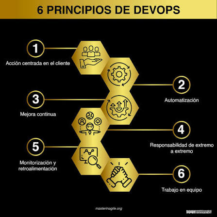

# 1.- Principios de Devops

DevOps es una metodología que une el desarrollo de software (Dev) con las operaciones de sistemas (Ops) para mejorar la colaboración y acortar el ciclo de vida del desarrollo.

### Principios clave:
* **Colaboración y comunicación:** Derribar barreras entre equipos.
* **Automatización:** Agilizar tareas repetitivas.
* **Mejora continua:** Aprender de fallos e iterar rápidamente.
