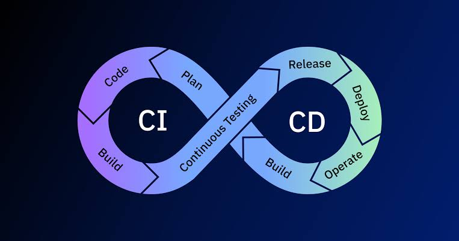

# 3.- Herramientas CI/CD

La Integración Continua (CI) y el Despliegue Continuo (CD) permiten validar y desplegar cambios de software de manera automatizada.

### Herramientas comunes:
* **Jenkins:** Servidor de automatización de código abierto.
* **GitLab CI / GitHub Actions:** Flujos de trabajo automatizados integrados en repositorios.
* **ArgoCD:** Entrega continua declarativa para Kubernetes.
